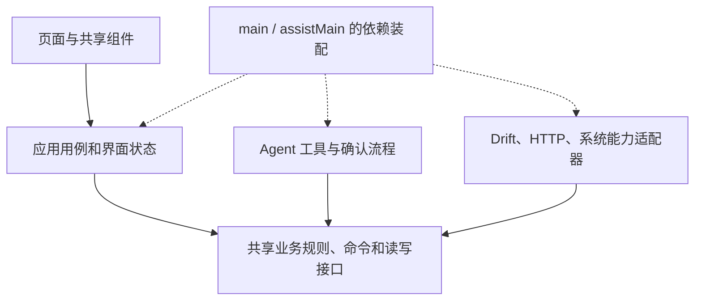

# ToWork 双端并行开发与维护改造计划

2026-11-19。对象为 Android 和 iOS，现有 macOS 客户端继续参与共享代码回归。本文给出实施顺序、合并依赖、验收和故障恢复方式。排期和效率目标为估算值。

**继续维护一个 Flutter 应用，一项业务只实现一次。** 把平台独有的权限、生命周期和分发行为放在独立适配层。每个跨端需求先合并行为契约和测试样例，再让共享界面、Android、iOS 分别开发。交付单位是同一源码提交在各平台的验收记录，各端可以按自己的渠道上线。

## 实施记录

2026-11-19。P0 的完整本地输入保存在 `refs/towork/architecture/input-20261119`（`845c2cb`）。在独立 worktree 校验离线语音资源并通过 1,187 项普通测试。工具链为 Flutter 3.47.5、Dart 3.13.4，pubspec.lock 的 SHA-256 为 `5e15b69ddabdd48e5b2575c6eef3165837a0669f36dad31f3db255f2657aa3a5`。原 Android 宿主 1.1.11+16 的 APK 摘要为 `9b84346466fab00025fe93b68fdbcaf85459309823649616fce685ba8b61d7cc`，编译基线为 `.flutter_patcher/baselines/release-default-16-arm64-v8a.tar.gz`。历史 APK 对应的源码提交尚待核实。公开仓库从经过筛选的源码快照开始。[GitHub 仓库](https://github.com/libai1024/towork)

| 工作包 | 已实现与本地证据 |
| --- | --- |
| P1–P3 | 同一套新建、完成、重开断言已在 Android API 36 和 iPhone 17 Pro / iOS 26.5 验证。两端更换 PID 后保留同一实体 ID 和版本 2。Android 快问先写入，主引擎读回并消费一次交接。iPad Pro 13 英寸 (M5) / iPadOS 26.5 模拟器的待办和日程页面均完成渲染并导出截图。 |
| P4–P7 | HTTP 网关注入外发授权，设置、聊天与报告共用网关。iPhone 模拟器用原生弹窗验证两个来源、缓存、拒绝、撤回、挂起期间切后台，回环服务只收到三次获准请求。取消和畸形返回另有契约测试。macOS 的 App Store 与官网下载两种分发策略分别通过契约测试。 |
| P8 | 拆出截止时间、提醒、重复规则和编辑控件。详情主体降至 975 行，文件体积守卫同步收紧。待办创建、完成、改期改用显式命令，保留版本复核与撤销。 |
| P9 | 已保存 schema 13 结构并与新库对照。两条后台连接并发从 12 迁移至 13，校验旧回执、凭据引用和待办。回执写入后注入故障，重启后保留先前提交。 |
| P10 | 设备作业、路径判定、失败产物与 `mobile-quality` 总结果已接入工作流。单端、共享、文档、未知路径及必跑作业被取消或跳过均有本地检查。 |
| P11 | Android 使用原宿主判断补丁兼容性。iOS 从相同候选源码归档。每端分别登记候选、设备验证与分发结果。 |

## 一、从五个项目追到实现

以下代码固定到 11 月 19 日调研时的提交。Stars 为当日仓库总数；Immich 和 Ente 只分析移动客户端。[前期选样与仓库对比](ARCHITECTURE-DIRECTION-2026-11-19.md)

| 项目 | 实际跟读的链路 | ToWork 采用的设计及边界 |
| --- | --- | --- |
| AppFlowy，79,181 | 看板构建器按设备选择桌面或移动页面，同一个视图控制器传给相应页面；移动页面创建 BoardBloc。移动卡片调用控制器，创建卡片则通过 RowBackendService。项目单独测试创建卡片的业务状态。 [页面选择][af-page] / [移动端装配][af-mobile] / [创建卡片][af-create] / [业务测试][af-test] | 复用数据操作和可观察状态，各入口自行管理筛选、弹层和焦点。ToWork 已有 Riverpod、TodoViewModel 和工作区命令，能实现这种分工。重构先从待办详情编辑器入手。 |
| LocalSend，99,676 | 后台上传事件进入发送 Provider，文件进度另按 sessionId/fileId 更新。进度页面读取独立进度；源码还解释了深比较整个文件集合的代价。测试专门让远端响应晚于本地取消到达，确认本地会话保持结束。 [上传事件][ls-send] / [进度页][ls-progress] / [取消竞态测试][ls-test] | 音量、部分转写、生成中的会话文本都有不同更新频率；先测哪些组件在重建，再缩小订阅。放开手指或取消后收到晚到识别结果，应按 captureId 丢弃。选择订阅粒度要把比较成本也算进去。 |
| Immich，119,595 | 相册页面订阅 Riverpod 投影，服务从 Drift 仓库得到变更流。测试创建有数据的旧库，两个后台连接并发触发迁移；另有集成测试冻结服务端流，再恢复应用，核对确实开启了新同步。Android、iOS 有各自构建作业。 [相册装配][im-provider] / [并发迁移][im-db] / [中断恢复][im-resume] / [双端构建][im-ci] | 主应用和快问都可先启动。保留 ToWork 的事务、回执和跨引擎刷新，补齐“上一正式版旧库被同时打开”的证据；把进程重启、恢复和写入可见性列为设备测试，分层测试使用可控替身。 |
| Ente，30,266 | Photos 的同一个插件在 Android、iOS 分别注册本端实现。Kotlin 和 Swift 适配器提供同一设备健康查询；Dart 用不同状态表达“平台不支持”和“目前取不到”，并测试非法数据。跨 Photos、Auth 等独立产品的组件才进入 workspace 共享包。 [工作区][en-ws] / [Kotlin][en-kotlin] / [Swift][en-swift] / [Dart 验证][en-test] | 契约写清字段、状态和生命周期，两端可同时对固定样例实现。ToWork 主聊天、快问、iPad 与手机目前都可直接复用应用内模块。出现独立消费者或独立构建需求时再评估拆包。 |
| FlClash，64,018 | Kotlin 快捷开关插件通过通道发事件，Dart Tile 转为监听回调，TileManager 绑定和释放监听，并根据运行状态决定是否触发操作。通道解析和管理器分别有测试，还有检查公共导出是否引入平台依赖的架构测试。 [Kotlin 插件][fl-native] / [生命周期][fl-manager] / [通道测试][fl-test] / [依赖检查][fl-lint] | 系统双触属于 Android 宿主，接收事件、去重和执行命令可以分开验收。沿用现有 AssistChannel；有新平台依赖时，在现有架构测试中约束它能被哪些目录导入。 |

## 二、当前起点与目标边界

| 当前工作区事实 | 改造落点 |
| --- | --- |
| 当前 checkout 位于 `codex/ui-home-refresh`，存在大量已修改及未跟踪文件，当时未配置 Git 远端。新 worktree 默认只含已提交内容。 | 先核对并选择已交付源码形成可还原的本地基线，保留进行中的修改。对齐源码、两端版本与发行记录后再从同一提交分工。本地即可验证合并；远程 PR、分支保护和托管 CI 需要可用的源码托管仓库。 |
| `features` 用共享状态和命令，`domain`、`data`、`app` 已有依赖方向测试。待办详情 1,885 行，待办列表 1,345 行，数据表详情 1,113 行。 [依赖守卫](../test/architecture/layer_dependencies_test.dart) / [待办详情](../lib/core/todo/todo_detail_sheet.dart) | 保留顶层目录。详情中的日期、提醒、重复规则编辑器按职责放在 `core/todo/`；跨入口复用的保存协调放在 `app/todo/`，事务继续由数据层负责。单页专用部件放回对应 feature。 |
| 聊天和设置使用模型网关，报告有自己的默认构造路径。当前网关直接调用 Apple 授权方法，用户拒绝时已有“零网络请求”测试。 [HTTP 网关](../lib/data/ai/openai_compatible_gateway.dart) / [模型装配](../lib/app/model_settings_provider.dart) / [报告](../lib/app/report_generation.dart) / [现有测试](../test/data/ai/apple_consent_test.dart) | 以模型请求授权为首个契约试点。共享方负责何时授权、拒绝后的行为和测试；iOS 负责系统弹窗与持久化；Android 验证现有直连策略。报告和聊天都接入同一装配约定。 |
| 数据库 schema 为 13。现有测试已覆盖两引擎同时首次建库、外部写入刷新、幂等重试和部分旧库迁移。 [数据库](../lib/data/local/app_database.dart) / [引擎测试](../test/app/engine_sync_test.dart) / [命令测试](../test/data/local/workspace_command_store_test.dart) | 下一次 schema 变化时，以当前正式版生成脱敏测试夹具，验证两个连接同时升级旧库、关键字段与工具回执保留。以后随正式 schema 滚动维护夹具。 |
| CI 的原生矩阵包含 APK、macOS。iPhone 1.1.11 (16) 有模拟器业务回归记录，iOS 和 iPadOS 共用构建。Android 基础包和代码补丁已有独立发布机制。 [CI](../.github/workflows/flutter.yml) / [iOS 记录](release/ios/listing.zh-Hans.md) / [Android 手册](release/README.md) | PR 增加 iOS 模拟器无签名构建；双端跑同一业务旅程。模拟器、真机、签名归档和分发状态分别记录，保留现有 macOS 保护。 |

### 代码归属

| 工作线 | 写入范围和交付物 | 需要协调的边界 |
| --- | --- | --- |
| 共享业务与 UI | `domain/` 定义命令、回执和能力；`app/` 装配并提供投影；`features/`、`core/`、`theme/` 实现交互；`data/local/`、`agent/` 维护持久化和工具协议。 | 同一业务操作走已有工作区命令。AI 提案保留二次确认、版本检查、业务写入和工具记录的原子性。 |
| Android | `android/` 的 Activity、引擎、插件、权限和重启；平台专用 Dart 适配与端测。 | 维护主引擎与快问并存、旧宿主能力、补丁兼容。界面层只消费能力契约。 |
| iOS | `ios/Runner/`、Swift 适配、权限文案、隐私清单、iPhone/iPad 端测与归档。 | 当前本地通知适配显式覆盖 Android、macOS；iOS 的不支持状态要如实呈现。后续补齐机能另按产品需求排期。[通知实现](../lib/data/notifications/native_notification_service.dart) |
| 集成与发行 | `.github/workflows/`、`tool/`、测试夹具、构建环境和版本台账。可由上述人员轮值。 | 路由注册、`pubspec.yaml`、锁文件、schema 版本、发行清单由各变更指定一位合并负责人。只有实际改到同一个入口的任务需要排队。 |

共享界面从 Riverpod 取得能力。系统通道名、原生回调、平台异常翻译留在适配器，装配点沿用 `app/`。现有 `SpeechInput`、`AssistEntries` 和 `CodeUpdateGateway` 继续作为各自领域接口。新增守卫先约束试点范围，已有历史依赖随所在模块改造。[语音契约](../lib/domain/speech/speech_input.dart) / [快问契约](../lib/domain/assist/quick_assist.dart) / [代码更新契约](../lib/domain/update/code_update.dart)

### 系统分层评审与目标设计

建议保留**模块化单体**。待办、业务表、对话与 Agent 是同一 Flutter 应用内的功能模块，可共用一个本地数据库和事务。Android 与 iOS 的共同维护边界定在应用用例和领域规则。平台相关的实现从装配入口注入。页面读取已提交的状态，应用用例生成写入命令，存储适配器负责跨实体提交和回滚。

图中实线表示源码依赖，虚线表示入口装配。运行时，应用用例调用注入的接口，由 Drift、HTTP 或平台通道的实现完成操作。



| 优先级与边界 | 改造前观察 | 目标和验收 |
| --- | --- | --- |
| **优先 1 / 工作区读取与写入** | `TodoStore` 同时暴露查询、添加、删除、全量恢复。生产读取对象 `LocalTodoProjection` 继承可写仓库，再在写入状态时抛出异常。界面因此能在编译期调用生产环境禁止的操作。新建表单的正常路径已经会等待持久化回执。 [读取对象](../lib/app/local_workspace_session.dart) / [仓库契约](../lib/domain/repositories/todo_store.dart) / [表单入口](../lib/core/todo/create_todo_sheet.dart) | 给页面和派生 Provider 一个只读接口。写入走已有异步命令，返回受影响实体和回执，再刷新读取状态。先改“新建待办”。验收包含页面调用方只能读、写入失败保留草稿、同一操作重试只产生一个实体，主界面与快问重开后结果一致。 |
| **优先 1 / 业务操作与界面反馈** | `WorkspaceUiCommands.run` 建立待办和分类的内存草稿，执行业务修改，再遍历两组前后快照生成差异。同一文件还提供依赖 `BuildContext` 的 Toast 包装器。短期便于复用旧编辑逻辑，长期会让新增一个待办也经过集合比较。 [当前命令路径](../lib/app/workspace_ui_commands.dart) / [待办入口](../lib/app/todo/async_todo_commands.dart) | 将提示、文案、弹窗留在界面。先为“创建待办”直接生成现有 `WorkspaceCommand`，保持操作 ID、实体 ID、来源、提醒、日期、初始状态与撤销语义。UI 与 AI 经各自输入处理后复用适用的业务规则，AI 单独保留权限和提案审核。用同一时钟、样例和旧实现对比命令及最终数据。对子树删除等批量操作继续使用已验证的路径。 |
| **优先 2 / Agent 策略与事务** | `SqliteAgentToolExecutor` 同时处理提案构造、选择哪些工具可执行、版本复核、实际写入和日志。现有实现的关键价值是把业务结果和对应工具事件放在同一 SQLite 事务中。 [执行器](../lib/data/local/agent_tool_executor.dart) / [失败注入测试](../test/agent/agent_runner_test.dart) | 按改动需要迁出纯决定逻辑，如“某组已选调用对应哪份提案”和“何时需要重新确认”。最新权限、模型配置、已保存提案和实体版本仍在提交事务内复核。写入、工具事件、回执继续共用一个事务。用日志写入失败注入证明三者同时回滚。 |
| **优先 2 / 依赖装配与领域纯度** | HTTP 网关直接调用 Apple 授权。`domain` 中有 6 个 Dart 文件直接导入 Flutter、Riverpod 或 `dart:ui`，包括继承 StateNotifier 的仓库和使用 Color 的领域对象。架构测试目前跳过外部包 URI，对 `agent` 的出向依赖也没有与 `domain` 同等的限制。 [模型网关](../lib/data/ai/openai_compatible_gateway.dart) / [领域 Store](../lib/domain/repositories/list_store.dart) / [依赖测试](../test/architecture/layer_dependencies_test.dart) / [规则](../test/architecture/source_rules.dart) | 先按 P4–P7 注入模型授权策略，并在新增领域规则和 Agent 规划器上限制 UI、插件、Drift 依赖。仅装配点选择平台实现。随后把订阅和 StateNotifier 留在应用侧。业务颜色逐步使用已有持久化 ARGB 值，UI 映射为 Color，保留既有数据库格式和旧记录读取。 |
| **按测量推进 / 工作区读模型** | 工作区监听把待办、分类、重复序列、业务表、数据行和表类型合成一个快照。会话收到新实体版本后会重新生成待办与分类列表。跨引擎检测到外部提交还会触发全表刷新。现有数据行分页查询已能单独执行。 [快照查询](../lib/data/local/workspace_command_store.dart) / [会话投影](../lib/app/local_workspace_session.dart) / [引擎同步](../lib/app/engine_sync.dart) / [数据行分页](../lib/data/local/sqlite_row_query.dart) | 在相同设备上分别记录“改一行表格”和“完成一个待办”触发的 SQL 次数、解码行数与列表刷新次数。若无关模块的开销随数据量增长，再按查询用途拆流。提交、恢复和跨实体校验仍可使用一致快照，保留双引擎外部变化检测和失败后重试。 |

P8 可先把 Toast 等展示逻辑移回界面并完成编辑组件拆分。第一轮系统分层试点由共享业务负责人负责，用一个独立变更把“创建待办”接到只读状态和显式命令。数据负责人用 P9 的真实库样例复核。稳定后才扩至完成、改期。Agent 纯策略拆分在事务失败回归就绪后独立推进，平台授权继续走 P4–P7。领域颜色和大数据量读模型放在后续维护周期，分别用旧库兼容和性能基线决定时机。原排期仍对应既定工作包，这些后续改造单独估工。

**创建待办试点进度（2026-11-19）**　页面和总览已改接只读查询。手动创建直接提交单条命令，沿用原有实体 ID 格式，并由提交事务确定排序和完成时间。快问仍通过 Agent 提案和确认写入。已增加跨连接丢回执重试、同 ID 不同内容冲突以及重开校验。详情见[当前架构](ARCHITECTURE.md)、[事务回归](../test/app/workspace_ui_commands_test.dart)和[移动端用例](../integration_test/free_workspace_ui_test.dart)。

试点验收通过 `bash tool/check.sh`，静态分析通过，全量 1,187 项测试通过。Android API 36 和 iPhone 17 Pro（iOS 26.5）模拟器均从页面创建、完成待办，再关闭数据库并重新挂载应用核对 ID 和状态。Android 另在快问界面通过脚本模型发起创建，确认前核对无写入，确认后从主界面重新读回同一 ID。两端均使用隔离测试库。

## 三、一次需求如何并行交付

以模型请求授权为例，这次重构应保持用户可见行为。先提交一份小接口、一组输入输出样例及可注入替身。契约分支合入集成基线后，三条线都可从同一提交开始。

| 场景样例 | 共享业务与测试 | Android | iOS |
| --- | --- | --- | --- |
| 首次向新模型地址发送对话 | 输入为实际请求的 origin 及供应商名；模型 HTTP 请求在授权完成后发出。覆盖聊天、连接测试中实际发送内容的路径和报告。 | 既有 Android 策略直接放行；断言不会调用 Apple 通道。 | 弹窗准确显示该 origin；同意后放行该次请求；同 origin 后续沿用已保存选择。 |
| 拒绝、撤回、地址改变 | 拒绝或授权失败时，测试服务端收到 0 次内容请求；再次授权成功后只收到 1 次。地址变更重新按 origin 判断。 | 用假通道和回环服务器验证 Android 仍可完成原请求。 | 拒绝保留编辑内容，撤回能清除已授权来源。宿主缺少所需通道或返回畸形结果时停止传输。 |
| 授权等待期间取消 | 用可控 Future 延迟结果；取消后，即使旧请求收到同意也不能恢复发送。 | 核对取消行为与模型切换回归。 | 验证切前后台、弹窗关闭、请求取消时回调只结算一次。 |

兼容方式是先增加可选的依赖注入入口和覆盖样例，旧调用路径继续沿用有效策略；再显式改接两处装配。默认实现必须保留 Apple 的授权约束。只有所有生产构造路径和测试都改接后才删除旧入口。测网络行为可以使用现有回环 HTTP 服务，系统弹窗另在 iOS 宿主实测。试点不把模型目录读取等其他请求混入原有授权语义。

日常提交从同一集成提交开短期功能分支，目录按上表分工。契约 PR 给出请求、返回、失败、取消、最低宿主能力和样例。新增通道优先增加可选字段或方法；共享代码对旧宿主可识别“未实现”，按当前功能的规则降级。涉及外发授权时该结果必须中止请求。破坏性变更拆成“先兼容两种协议 → 更新调用方 → 旧宿主退出支持后移除旧协议”。评审以契约和端测结果为依据，每个 PR 标明所依赖的提交及所触及的平台。

## 四、实施工作包与合并依赖

估算按 **两名开发者各主责一端、共享业务和 CI 有半职到一人并行投入**。首个里程碑是拿到双端反馈。主体约 3–4 周，另观察两个发布周期。若同一人包办所有工作，按人日顺序排期。Apple 审核、远端开通及设备排队时间单独计算。编号表示交付物，依赖列决定开工顺序。

| 编号 | 前置 | 主责 | 变更与交付物 | 退出条件 | 估算人日 |
| --- | --- | --- | --- | --- | ---: |
| P0 | 无 | 集成 | 盘点工作区及未跟踪源码；区分当前候选、历史发行和其他进行中修改。为选定候选建立可重现的提交或本地标记，登记 SDK、锁文件、原生产物摘要和补丁基线位置。签名、生产库和模型凭据独立保存。 | 从该提交在隔离目录还原并跑质量门。无法证实历史发行来源的记录标为待核实。 | 1–2 |
| P1 | P0 | 共享 | 用现有工作区集成测试提炼共用夹具和稳定控件标识，写“新建 → 完成 → 关闭进程 → 重开读回”移动冒烟场景。区分首次初始化和重开，用相同测试目录衔接两次启动。 | 两个宿主均可消费相同的业务断言，夹具不需网络 Key，能在自己的应用容器重跑。 | 2 |
| P2 | P1 | Android | 接 Android CI 设备作业，安装测试包并执行两次进程启动；另测快问先启动、主界面共存、交接只消费一次。输出 logcat 和失败截图。 | 安卓共用旅程通过；快问实例写入后，主界面能观察到同一条记录。 | 2–3 |
| P3 | P1 | iOS | 接独立 macOS runner，选定 Xcode 与可用模拟器 runtime，构建无签名 Runner；按同一 app 容器终止并重启，输出日志和失败截图。 | iPhone 共用旅程通过；单独记录 iPad 布局。签名凭据只用于候选归档。 | 2–3 |
| P4 | P0 | 共享 | 建立模型外发授权的窄契约、替身和第三节样例，保留兼容入口；梳理设置、聊天、报告的实际构造路径。 | 回环服务验证允许、拒绝和晚到回调，现有调用方运行正常。 | 2 |
| P5 | P4 | iOS | 将既有 Swift 授权桥接到试点契约，补充通道结果解析、撤回和原生弹窗检查。 | iPhone 对两个不同 origin 分别授权；撤回后再次询问；拒绝时网络请求数为零。 | 2–3 |
| P6 | P4 | Android | 验证 Android 放行实现及缺省能力处理，覆盖主界面与快问装配。与 iOS 使用同一组授权样例。 | Android 聊天、报告保留行为，通道日志没有 Apple 方法调用。 | 1 |
| P7 | P5、P6 | 共享 | 将聊天、设置及报告完整改接统一授权装配，处理创建与释放；收窄试点模块对平台实现的直接依赖，将约束加入架构测试。 | 所有实际内容发送路径都有验收；移除用不到的过渡入口。macOS 商店与官网下载两种分发行为分别核对。 | 2 |
| P8 | P0 | 共享 UI | 单独拆出待办详情中的截止时间、提醒、重复规则编辑器。第一步只迁移部件；下一步仅在需要时抽取串行保存协调。 | 各业务入口可编辑同一待办；保存中继续打字、关闭等待写入、失败保留草稿、重试不重复写入均通过。基线随实测收紧。 | 3–4 |
| P9 | P0 | 数据 | 整理上一正式 schema 的真实结构与合成记录；验证双连接冷开、并发写入、写入中断、恢复和回执。当前 schema 13 建立起点，下次真实升级加入 13 到目标版本的并发迁移用例。 | 两连接读到目标版本和相同业务结果；同操作只产生一次业务效果；错误回滚后可重开旧数据；AI 表结构提案仍须二次确认。 | 2–3 |
| P10 | P2、P3 | 集成 | 合并双端 CI，配置变更触发和总结果，关联已有 macOS 作业。相同路径样例验证哪些作业应启动。 | 同一提交能查到双端结果；单端失败能定位日志，失败的必跑作业会阻止合并。 | 2 |
| P11 | P7、P8、P9、P10 | 发行 | 用一个候选源码做预发布演练，分别生成 Android 候选和 iOS 归档；演练补丁撤回或向前修复，建立版本台账。 | 给出两个平台独立的可发判断、回退路径及持续维护负责人。正式分发按各自渠道操作。 | 2–3 |

**排期与第一批分工。** 第 1 周先做 P0，随后 P1、P4、P9 可分开开工。第 2 周两端各自完成 P2/P6 和 P3/P5，共享开发空档推进 P8。第 3 周汇合 P7、P10，补真实设备差异，进入 P11；签名、运行环境或回归问题较多时使用第 4 周。每个 worktree 只改自己的任务；库升级、锁文件和路由汇总指定一个合并者。同一 worktree 的 Flutter 命令串行，CI 并行使用独立 checkout、构建目录、模拟器和测试数据库，签名发布沿用现有锁。

### 第一批可直接认领的改动

- **共享负责人**在 P1 封装合成数据、固定日期和两次启动之间的业务 ID。建议新增 `integration_test/mobile_todo_smoke_test.dart`；宿主驱动保存第一阶段的 ID，第二阶段按该 ID 读回，避免读到种子数据也判为成功。P4 的行为样例放在 `test/data/ai/`，与现有授权测试共用回环服务。
- **两端负责人**分别交付 Android 的 adb 驱动、iOS 的 simctl 驱动和各自的 CI 作业；在共用夹具合入前，可先用当前正式入口验证模拟器安装、终止和启动。进程退出前等待保存回执，再终止进程。两次启动之间保持同一应用标识、同一数据库和同一安装。
- **集成负责人**在 P10 汇总作业，统一失败产物和命名。现有 PR 模板增加三项即可：影响的端、契约或数据库是否变化、同一提交的验收链接。单端热修用短分支从对应发布来源切出，修复合回集成分支，后续发布复用同一变更。[现有 PR 模板](../.github/pull_request_template.md)

## 五、CI 与验收矩阵

保留 `bash tool/check.sh` 作为共享质量门。先无条件跑通双端任务再优化触发，避免早期漏测。共用旅程用公开接口驱动界面、合成数据和隔离数据库；第二次启动保留容器，普通 widget 重挂载只作为快速回归。[质量门](../tool/check.sh) / [工作区夹具](../integration_test/free_workspace_ui_test.dart) / [草稿持久化](../test/workspace_capture_persistence_test.dart)

| 变更或时机 | 共享验证 | Android | iOS |
| --- | --- | --- | --- |
| PR 修改共享 Dart、资源、插件、锁文件、契约或 CI 路径判定 | 格式、分析、架构、单元和 widget；受影响契约样例 | 模拟器构建与共用旅程 | 模拟器构建与共用旅程 |
| PR 只改原生宿主 | 维持基础质量门；通道签名变化按双端契约处理 | Android 路径跑本端，覆盖注册、解绑、宿主重建 | iOS 路径跑本端，覆盖权限和前后台状态 |
| PR 修改库或 Agent 写入 | 旧库夹具、失败回滚、幂等、并发、提案确认及过期版本 | 加主应用与快问双连接场景 | 加普通启动与重新打开数据场景 |
| 文档、定时和候选 | 纯文档检查引用；定时跑完整设备组合，候选重跑关键流程 | ARM64 正式宿主验证 Pn 到下一补丁、进程重启、再次冷启动、APK 安装信息；华为双触用真机 | iPhone/iPad 模拟器覆盖布局；签名候选用 TestFlight 和 iPhone 真机验麦克风、拒绝/撤回、恢复 |

总结果作业读变更分类和实际退出状态，区分“本次无需运行”“通过”“失败”“取消/未启动”。路径未知、工作流或依赖变更时跑双端。平台专用 Dart 在第一阶段也按共享代码处理。Flutter SDK 固定到仓库版本；缓存按 OS、架构、SDK、锁文件区分，iOS 另带 Xcode 版本。记录构建、设备启动和业务测试三段耗时。某端 runner 暂不可用时，先可在受控设备复跑同一 SHA 留证，再补 CI 记录。

**当前可复跑的基线。** 本次在原工作区执行 `bash tool/check.sh`，静态分析、4 项架构检查和全量 1,186 项普通测试通过。该命令运行单元及 widget 测试；Android、iOS 设备作业在上表单列。试点开发时可先运行下列定向用例，再走全量门禁。

```sh
flutter test --no-pub test/data/ai/apple_consent_test.dart test/data/platform/assist_channel_test.dart
flutter test --no-pub test/app/engine_sync_test.dart test/data/local/workspace_command_store_test.dart
flutter test --no-pub test/workspace_capture_persistence_test.dart
```

## 六、独立发布、兼容与恢复

每个候选建立一条版本记录，字段包括源提交、Flutter/Dart 与锁文件摘要、数据库版本、平台契约版本或变更摘要，以及公开发行日志。Android 分列 versionCode、宿主基线、patch_seq、产物 SHA-256；iOS 分列营销版本、CFBundleVersion、归档标识、TestFlight 与商店状态。两个平台分别标记“已构建、端测通过、已分发”，台账可直接回答某个修复在哪个版本可用。

| 故障 | 处置与恢复验收 |
| --- | --- |
| Android 补丁与旧宿主动态接口不兼容 | 通过原基线编译判断；宿主、插件或 SDK 变更走新基础包及既有 APK 差量流程。线上补丁有问题时，按发布手册撤回兼容补丁或发布修复版，在原包内验证下载、重启和冷启动。[发布脚本](../tool/publish_code_patch.sh) / 更新设计 |
| iOS 候选失败或审核滞后 | 暂停该 build 的推广，保留上个可用渠道版本，用更高 build 号向前修复。已经安装问题版本的用户通过后续修复更新；Android 的独立修复可照常验收和分发。[苹果分发记录](release/ios/listing.zh-Hans.md) |
| 新版本已写入新数据格式 | 先评估旧代码能否读新结构。采用兼容的新增字段/表、迁移、延后清理；仅在验证旧读者兼容时回退代码。遇到不可逆结构变化走向前修复，保留用户数据；验证重开、回执和跨引擎读取。 |

## 七、怎样判断并行开发真的更快

在 P0 记录近期可追溯改动的基线；样本不足时用首批 10 个合并请求建基线。之后按两个发布周期复盘。以下为试行目标，由团队按实际 runner 与设备资源调整。

| 指标 | 采集方式与目标 |
| --- | --- |
| 双端反馈时间 | 从提交到 Android、iOS 均返回必跑结果；看 p50/p95，另列排队和实际运行时间。首要目标是所有共享变更都拿到两端结果；再以基线为准争取 p50 缩短 25%。 |
| 等待与冲突 | PR 记录因等待另一端接口或争用同一文件而停工的工作日。第二周期争取中位等待不超过 1 个工作日；若仍集中在路由、锁文件或装配点，再调整归属。 |
| 发布可追溯性 | 抽查每个正式版本，100% 能由平台版本查回源码和设备验收，也能由修复提交查回两端分发状态。 |
| 行为一致性 | 两端共用旅程全过，授权拒绝时 0 次内容请求，同一操作重试产生 1 份业务结果，已保存数据在重启后可读。平台独占功能按各自矩阵验收。 |

P11 之后按变化频率选择下一处。优先看待办列表和数据表详情的维护范围；语音与长对话使用相同合成样本采集重建次数和帧耗时，再决定是否拆细订阅。出现独立消费者、可测性能瓶颈或平台开发布署需要时，再评估独立 Dart 包、专用插件或跨语言核心。

[af-page]: https://github.com/AppFlowy-IO/AppFlowy/blob/8fcee27d9bd93aad4ee0191d5d8d915d6a9a4e93/frontend/appflowy_flutter/lib/plugins/database/board/presentation/board_page.dart#L48
[af-mobile]: https://github.com/AppFlowy-IO/AppFlowy/blob/8fcee27d9bd93aad4ee0191d5d8d915d6a9a4e93/frontend/appflowy_flutter/lib/mobile/presentation/database/board/mobile_board_page.dart#L63
[af-create]: https://github.com/AppFlowy-IO/AppFlowy/blob/8fcee27d9bd93aad4ee0191d5d8d915d6a9a4e93/frontend/appflowy_flutter/lib/plugins/database/board/application/board_bloc.dart#L113
[af-test]: https://github.com/AppFlowy-IO/AppFlowy/blob/8fcee27d9bd93aad4ee0191d5d8d915d6a9a4e93/frontend/appflowy_flutter/test/bloc_test/board_test/create_card_test.dart#L15
[ls-send]: https://github.com/localsend/localsend/blob/e05d12a9c0fd4d8c0245d2ec5c3c177e7e0f759b/app/lib/provider/network/send_provider.dart#L678
[ls-progress]: https://github.com/localsend/localsend/blob/e05d12a9c0fd4d8c0245d2ec5c3c177e7e0f759b/app/lib/pages/progress_page.dart#L196
[ls-test]: https://github.com/localsend/localsend/blob/e05d12a9c0fd4d8c0245d2ec5c3c177e7e0f759b/app/test/unit/provider/send_provider_test.dart#L88
[im-provider]: https://github.com/immich-app/immich/blob/557c854489f931e9ab906c6f550c44be05179288/mobile/lib/providers/infrastructure/album.provider.dart
[im-db]: https://github.com/immich-app/immich/blob/557c854489f931e9ab906c6f550c44be05179288/mobile/test/drift/main/concurrent_migration_test.dart#L33
[im-resume]: https://github.com/immich-app/immich/blob/557c854489f931e9ab906c6f550c44be05179288/mobile/integration_test/failed_sync_resume_e2e_test.dart#L70
[im-ci]: https://github.com/immich-app/immich/blob/557c854489f931e9ab906c6f550c44be05179288/.github/workflows/build-mobile.yml#L255
[en-ws]: https://github.com/ente/ente/blob/6b913616b722f80f5a2c3667ca457bd0d8cf0eed/mobile/pubspec.yaml#L15
[en-kotlin]: https://github.com/ente/ente/blob/6b913616b722f80f5a2c3667ca457bd0d8cf0eed/mobile/apps/photos/plugins/ente_photos_platform/android/src/main/kotlin/io/ente/photos/platform/flutter/DeviceHealthChannelAdapter.kt
[en-swift]: https://github.com/ente/ente/blob/6b913616b722f80f5a2c3667ca457bd0d8cf0eed/mobile/apps/photos/plugins/ente_photos_platform/ios/Flutter/DeviceHealthChannelAdapter.swift
[en-test]: https://github.com/ente/ente/blob/6b913616b722f80f5a2c3667ca457bd0d8cf0eed/mobile/apps/photos/plugins/ente_photos_platform/test/device_health_test.dart#L5
[fl-native]: https://github.com/chen08209/FlClash/blob/be84736605527034689c95bf27828ff27d912c5e/android/app/src/main/kotlin/com/follow/clash/plugins/TilePlugin.kt#L9
[fl-manager]: https://github.com/chen08209/FlClash/blob/be84736605527034689c95bf27828ff27d912c5e/lib/manager/tile_manager.dart#L28
[fl-test]: https://github.com/chen08209/FlClash/blob/be84736605527034689c95bf27828ff27d912c5e/test/plugins/tile_test.dart#L52
[fl-lint]: https://github.com/chen08209/FlClash/blob/be84736605527034689c95bf27828ff27d912c5e/test/lint/platform_layering_test.dart
