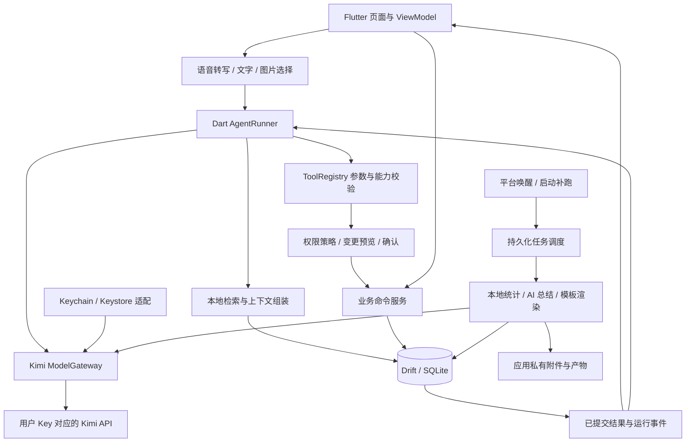

# 免费版架构：本地业务与端侧 Agent

> 日期：2026-09-23。方案状态：建议设计，未实现。范围与免费/商业边界见 [总览](README.md)，组件选择见 技术栈。

## 1. 架构原则与数据流

SQLite 是免费版业务数据的唯一权威来源。模型只能提出工具调用；App 中的业务命令负责校验、权限、事务和回执。语音、手动页面与 AI 工具共享数据层，避免“AI 改了一套、界面编辑另一套”。

出设备的内容包括用户主动发送的对话、选中图片、相关工具结果和记忆片段，具体取决于该次请求；不自动上传整个数据库。系统语音识别可能使用系统服务商网络，必须与 Kimi 模型链路分别说明，见 平台边界。

网络适配、数据库访问和任务状态不依赖 Widget 或 BuildContext。沿用现有 Riverpod 和 ViewModel，按 Flutter 官方分层建议区分视图、仓库和服务，不为接入 Agent 更换整套状态管理。[Flutter 架构建议](https://docs.flutter.dev/app-architecture/recommendations)

## 2. 模块责任与代码落点

以下是建议新增/演进的位置，不表示路径中的实现已经存在。

| 模块 / 建议位置 | 责任 | 不负责 |
|---|---|---|
| `lib/app` | edition 选择、依赖注入、生命周期入口 | 业务校验与网络解析 |
| `lib/features/*/application` | 展示状态、用户意图、订阅已提交数据 | 直接执行 SQL、私藏一份可写数据 |
| `lib/domain/use_cases` | 待办、业务表、记忆、撤销等组合命令 | 模型供应商格式、系统 UI |
| `lib/agent` | `AgentRunner`、工具定义、确认提案、上下文预算 | 自由 SQL、Shell、任意文件操作 |
| `lib/data/local` | Drift schema、迁移、事务、索引与仓库 | 页面状态 |
| `lib/data/ai` | Kimi profile、SSE 解析、模型能力、错误映射 | 决定是否允许业务写入 |
| `lib/data/jobs` | 任务存储、抢占、重试、报告与记忆处理 | 假设 App 永久在线 |
| `lib/data/platform` | ASR、通知、凭据、文件、快捷键、系统调度适配 | 复制领域业务规则 |

保持当前目录结构，按功能逐步替换内存实现。现有 Store 带 Riverpod 状态、部分模型带 `dart:ui` 类型，不宣称已经是纯 Dart 核心。先将 AgentRunner、协议解析、权限与命令输入做成不依赖 UI 的模块；遇到后台引擎或独立测试需求时再抽离颜色/展示类型，无须一次性改造全工程。

## 3. 最小核心契约

| 契约 | 关键输入与输出 | 设计约束 |
|---|---|---|
| `ModelGateway.stream` | profile、消息、工具 schema、预算 → 模型事件流 | 保留供应商要求的完整消息与工具关联，不丢未知必要字段 |
| `AgentRunner.start/resume/cancel` | 会话、用户输入、runId → 持久化运行事件 | UI 消失不等于业务回滚；App 中断后可判断提交状态 |
| `ToolRegistry` | 工具名、schema 版本、参数 → 结构化提案/只读结果 | 工具名白名单；JSON 与业务语义双重校验 |
| `PermissionPolicy.evaluate` | 操作种类、当前档位、记忆暂停等 → 允许/确认/禁止 | 由代码执行；模型不可修改权限 |
| `CommandExecutor.commit` | proposalId、幂等标识、预期版本 → receipt | 事务中二次验证，输出实际写入结果 |
| `JobScheduler` | 唯一任务键、到期窗口、前置条件 → 状态 | 可重入、有限重试；平台负责唤醒，数据库负责真相 |
| `ReportRenderer` | 结构化 ReportDocument、模板、字体 → 图片/PDF | 同一统计快照渲染，模型不决定真实数值 |

默认只允许内部领域工具。MCP 是连接外部能力的协议，可在未来作为一个适配器引入；它不替代本地事务、权限和任务恢复。该划分与本次产品调研一致，首版无需开放 MCP 服务配置。[MCP 官方架构](https://modelcontextprotocol.io/docs/2026-07-28/learn/architecture)、案例结论

## 4. Agent 循环与恢复

建议持久化状态：`queued → generating → validating → awaiting_confirmation / executing → generating → succeeded`；终止分支为 `cancelled`、`failed`、`interrupted`。每个状态有时间戳、runId 和递增事件序号；`interrupted` 表示进程中断，不等于执行失败或尚未写入。

1. 结束录音后等待最终转写结果，忽略中间片段；用 inputId 防止重复结束回调发送两次。取消可中止待发送输入；若已有写入，按回执展示结果和撤销入口。
2. 创建 run，读取必要上下文、当前时间/时区、模型能力和权限快照。只读检索返回结构化摘要与记录 ID，限制条数和长度。
3. 向 Kimi 发流式请求。按请求及 tool index/id 聚合碎片，正确处理 UTF-8、SSE 帧跨 chunk、多工具调用、空 delta 与异常结束；完整收到合法参数后才能准备工具。
4. 工具请求必须完成 schema、字段、目标存在性、版本、动作范围校验。多轮指代不明确时询问用户，不从相似标题中静默挑一条删除。
5. 需要确认时持久化“目标、变更前后、影响数量、预期版本、参数摘要 hash”；显示业务语言卡片。确认与原提案绑定，不能批准一个之后被模型替换的动作。
6. 提交前重新读取权限与目标版本；权限收紧或目标已变化时重新评估。一个选中批次全成功或全失败；未选项保留待确认。
7. 原子提交业务数据、修改记录、工具回执和运行事件；把真实回执作为 tool result 回给模型，再生成用户可读答复。工具失败也要完整关联 tool_call_id，不能留下悬空的工具消息。
8. 达到轮次/时长/输入输出预算后停止并展示已有结果。建议初始最多 8 轮模型调用、有限修复重试，参数经真实样本校准；触限不撤销已完成的业务。

Kimi 各模型的思考参数和历史消息保留要求不同；适配层必须按能力保留 `reasoning_content` 等协议字段，不把所有模型当成可任意删字段的通用聊天接口。UI 不必展示原始推理内容，也不应把它写入普通调试日志。[官方思考模型与工具调用规范](https://platform.kimi.com/docs/guide/use-thinking-models)

### 幂等与崩溃窗口

| 中断位置 | 恢复动作 |
|---|---|
| 模型请求中，尚无完整工具提案 | 标记中断；用户重试同一输入，不能从半截 JSON 执行 |
| 提案已存，尚未提交 | 重新检查版本与权限；恢复确认卡，拒绝已过期提案 |
| SQLite 事务内中断 | 依数据库事务结果读取回执；不根据 UI 文案猜测 |
| 业务已提交，模型未收到 tool result | 返回已存 receipt，继续后续回答，不重复执行业务 |
| 最终回复未完成 | 显示已完成动作，可重试补充说明，不重放写入 |

回执的唯一键建议为 `(run_id, action_id)`；action 保存首次完整的 provider tool_call_id、规范化参数 hash 与 schema 版本。同键同参数返回原回执，同键不同参数拒绝。调用网络不放在数据库事务中。

这个机制保证已登记动作的业务效果不被重复提交；**不能保证模型请求只计费一次，也不能自动识别另一轮模型生成的新 ID 是否代表同一用户意图**。恢复必须沿原持久化动作继续；整轮重新规划前读取既有结果，必要时让用户确认，不能靠“同名待办去重”合并合法重复任务。

## 5. 本地持久化模型

| 数据组 | 建议实体 | 核心要求 |
|---|---|---|
| 用户与设置 | local_profile、preferences、provider_profiles | local_user_id 稳定；nickname 可变；profile 只存凭据引用 |
| 待办 | todos、recurrence_rules、occurrences、categories、tags | 版本号、来源、软删除；重复实例有稳定唯一身份 |
| 业务表 | table_schemas、field_definitions、rows、cell_values | 字段 ID 稳定；动态字段有类型与 schema 版本 |
| 会话与执行 | conversations、messages、agent_runs、proposals、tool_receipts、run_events | 区分展示消息和模型协议消息；事件可重放呈现 |
| 审计与撤销 | change_sets、record_changes | 操作人/Agent来源、修改前后、提交后版本；撤销检测后续编辑 |
| 记忆与检索 | memories、memory_sources、search_index、embedding_records | 暂停 epoch、来源可追溯、模型/维度/索引版本可重建 |
| 附件 | attachments、attachment_links | 本地资源 ID、hash、MIME、大小、相对路径；禁止模型提供任意路径 |
| 报告与任务 | reports、report_snapshots、artifacts、jobs、job_attempts | 输入快照、模板版本、生成状态、唯一任务键 |

建议业务表使用“稳定字段定义 + 类型化值 + 按需求建立索引”的受控结构；不要允许模型拼接 CREATE TABLE 或任意 SQL。金额避免浮点误差；日期与时间戳分开；带时间的事件保存 UTC 与时区语义。查询过滤字段、操作符和排序也经过白名单验证。

撤销是一个新的受校验命令，恢复受影响记录而不是恢复整个旧数据库。若记录在原动作后又被编辑，应提示冲突，不能覆盖后续修改。附件文件与 SQLite 无法组成同一事务：先写私有临时文件并校验，事务登记引用，再原子更名/更新就绪状态；启动清理孤立临时文件并修复未完成阶段。

## 6. 本地任务、报告与记忆

任务唯一键示例为 `(job_type, local_user_id, period_start, timezone, generation_revision)`。同一周的自动生成只有一份默认产物；用户点“重新生成”增加 revision，保留旧版直到新版完整落盘。job 保存到期时间、下一次尝试、尝试次数、输入快照、lease owner、过期时间与递增 lease_epoch。短事务抢占后适时续租，提交必须检查 owner/epoch/取消状态，拒绝已失去租约的旧 worker 回包，防止前台补跑和系统回调重复发布。

租约超时接管时，旧远程模型请求可能尚未结束，不能承诺所有故障下绝无并发请求或重复费用。停止旧本地调用、限制请求时间与接管重试频率，并用 fencing epoch 保护本地结果；只对持久化业务效果作可验证的幂等承诺。

报告拆为 `snapshot_ready → summary_ready → render_pending → completed`。先本地计算可核验指标，AI 只写基于证据的总结，再生成可选模板海报与导出文件。渲染失败只重试渲染，不重新花模型费用；摘要响应尚未持久化就崩溃时，仍可能需要重新调用模型，不能保证零重复费用。

自动任务延迟执行时仍按原报告周期取数，同时记录实际生成时间；长时间未开 App 时优先补最近一个周期，旧周期在报告页按需补生成，此补跑策略为建议默认值。定时生成、自动记忆提取会消耗用户 Key 用量，设置中提供开关和本地预算提示。

记忆包括显式“记住……”与会话后的提取；均执行 schema 校验、来源记录与暂停检查。暂停时停止新增记忆及相关自动任务，普通对话仍可继续。删除/清空增加 epoch，使旧任务和旧索引不得重新写回已删除内容。后台自动记忆和报告使用用户启用的专门设置作为授权，不把待办/业务表三档权限扩展成“所有内部状态落盘都要确认”；明确记忆命令的确认细则由 F3 冻结。关键词 + 向量混合检索仍在完整目标范围，端侧 embedding 与中文分词要先通过 技术栈中的专项验证，不能把关键词查询标成已实现语义检索。

Android/macOS 的后台调用与海报渲染方式分别验证，平台支持状态不由 Dart isolate 推导。isolate 可以隔离计算工作，但不会让 App 在退出或设备关机后继续存活。[Flutter isolates](https://docs.flutter.dev/perf/isolates)、平台执行状态

## 7. 免费与商业版如何共用代码

| 可以共享 | 必须区分 |
|---|---|
| Flutter 页面、ViewModel、主题、海报模板 | 免费 LocalAgentGateway / 商业 RemoteAgentGateway |
| 领域命令输入、DTO/schema、错误码与测试场景 | 免费本地 SQLite 权威写入 / 商业服务端权威写入 |
| 三档权限的行为规范、确认卡与版本冲突体验 | 本地最终授权 / 商业服务端最终授权 |
| 表格字段、统计口径、重复待办语义 | 本地任务唤醒 / 服务端任务执行与同步 |
| 文件导出格式及校验规范 | 本地 profile / 云端账户认证与订阅权益 |

商业后端若保持 Python，不能直接复用 Dart 可执行核心；共享的是协议、规范与同一组 fixture，分别验证行为一致。应用装配边界选择 edition 和具体适配器，避免每个页面散落 `isPro` 分支。商业版服务器独立核验账户和权益，客户端标志不作为服务端访问依据。

免费升级商业版是一条显式的数据迁移流程：预览上传范围 → 授权连接 → 上传带格式版本与校验的资料包 → 服务端导入/映射 → 对账 → 切换数据源。保留原本地备份，导入重复时以稳定 source/import ID 去重；不同云端账户的数据不自动合并。Key 默认重新配置，不随业务包上传；待执行 Agent 命令不作为迁移后可立即执行的任务恢复。

降级时先提供商业数据导出/本地导入，不承诺删除云端数据，也不把一次导入伪装成持续双向同步。具体订阅、退款、价格与商业运营规则不在本次免费版技术设计内。
